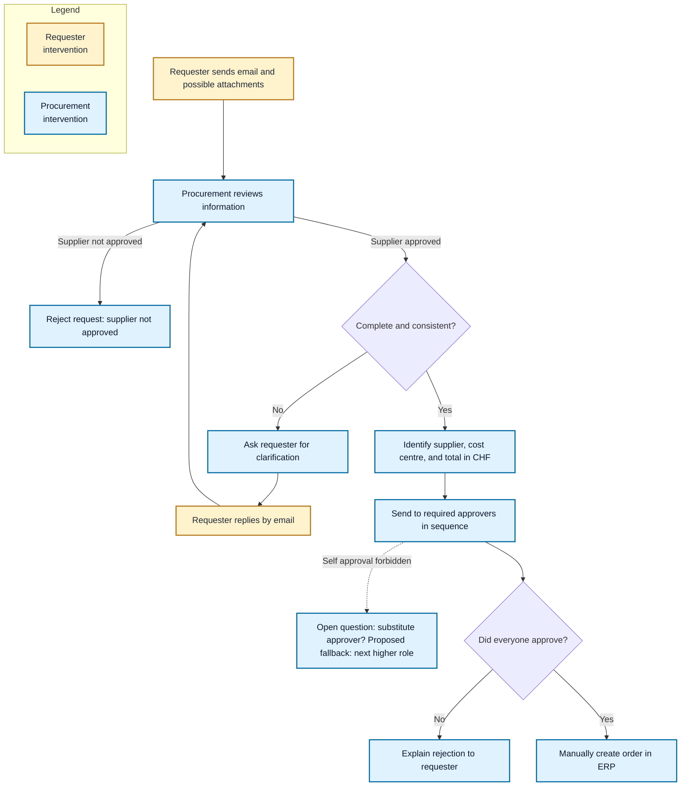
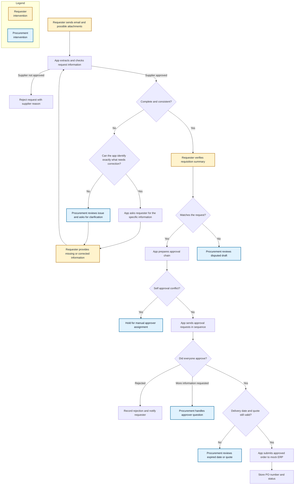
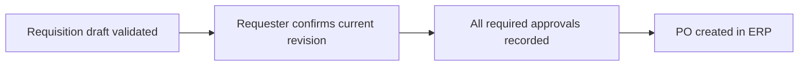
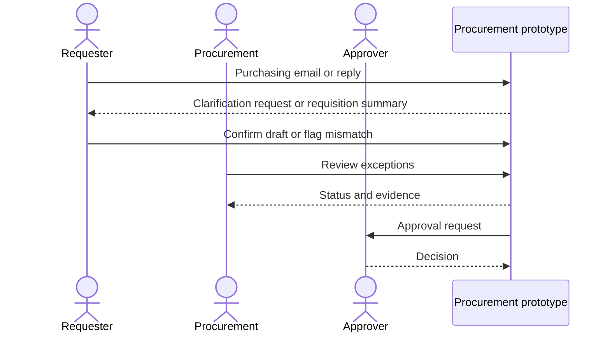
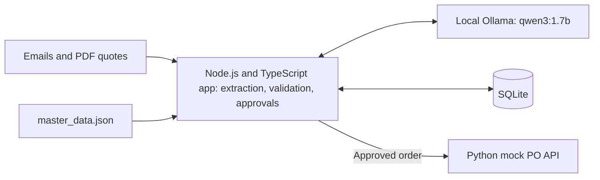
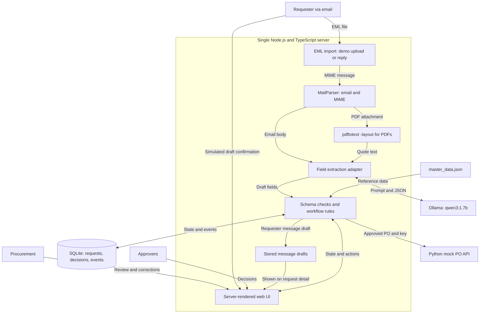

# Purchasing Requisition Challenge

## Objective

Turn purchasing emails and supplier quotes into requisitions. Route approvals in order. Create a PO through the mock ERP **only after approval**.

## What was supplied

The challenge supplied sample inputs, master data, and a mock API. The app in `src/` is the prototype built around them. Missing prices, vague requests, expired quotes, wrong totals, and unverified approval claims are test cases.

## Challenge requirements

1. Parse `.eml` messages and PDF quotes for supplier, items, prices, currency, cost centre, and delivery date.
2. Validate fields; request clear missing information and escalate ambiguity.
3. Convert totals to CHF; enforce sequential approvals and prevent self approval.
4. Record decisions; send approved requests to [mock_po_api.py](mock_po_api.py) with an idempotency key.
5. Commit the code to Git; submit a short README and video walkthrough as specified in the [brief](CHALLENGE_BRIEF.md.pdf).

## Run the prototype

Requirements: Node.js 24+, Python 3, Poppler (`pdfinfo`, `pdftotext`; `pdfunite` for one test), and local Ollama with `qwen3:1.7b`. Start Ollama (`ollama serve` if it is not already running). All services bind to localhost.

```bash
npm install
ollama pull qwen3:1.7b              # once, if missing
mkdir -p data
python3 mock_po_api.py 8080 data/mock_orders.json  # terminal 1
npm start                                       # terminal 2
```

Open **http://127.0.0.1:3000**. Import an `.eml` and optionally a PDF. Named sample PDFs resolve from `docs/quotes-*/quotes/`. For a currently valid end-to-end example, run `npm run demo-email` and import `data/demo_current.eml` (stable `Message-ID` for the day). Confirm the draft, approve each shown step, then create the PO. The supplied dated quotes are expired as of 2026-10-22, so they should stop in review.

- Open a request to see its clarification, confirmation, and rejection message drafts. They are not sent.
- Requester and approver clicks are simulated; there is no login or verified identity.
- [Video walkthrough](demo/walkthrough.mp4): 42-second silent, captioned run through confirmation, ordered approvals, PO creation, and an expired-quote hold.

## Duplicate protection

| Step | Identity | Repeat behavior |
| --- | --- | --- |
| Email import | File hash; sender + `Message-ID` | Return the existing request without extracting again. Same ID with changed content is blocked for review. |
| Reply | `REQ-XXXXXXXX` reference or `In-Reply-To` | Update the existing request as a new revision; reset confirmation and approvals. |
| ERP submission | `blp-<request>-<revision>-<payload hash>` | Store the exact payload and key in SQLite; retry the same pair. The mock ERP returns the original PO. |

A new email with a new `Message-ID` and no request/thread reference is a new request. Sender alone cannot identify duplicates: one person can make several purchases.

## Test bench

| Command | Coverage |
| --- | --- |
| `npm run check` | TypeScript type check. |
| `npm test` | 16 tests: validation, CHF approval chain and PO gate, email deduplication, reply/revision reset, PDF limits, model failure, stale dates, and ERP retry/idempotency. External LLM and ERP calls are mocked. |
| `npm run check-samples` | Parses all 48 supplied emails and 21 PDFs; does not score extraction accuracy. |
| `npm run eval-extraction` | Ten hand-labeled emails, including two PDF quotes, through local Ollama. Checks supplier, cost centre, dates, currency, totals, and line items. Exits nonzero on mismatches. |

### Extraction accuracy: 10 live tests

Run `OLLAMA_MODEL=qwen3:1.7b npm run eval-extraction`. The ten tests compare extracted fields against manually labeled emails; two include PDFs.

| Model and scope | Result | Extraction time |
| --- | --- | --- |
| `qwen3:1.7b`, all 10 | 4 pass (01, 05, 06, 14); 6 fail (02, 04, 08, 12, 13, 26) | 17–75 s per email |
| `qwen2.5:3b-instruct-q4_K_M`, email 12 | Pass | 55 s |
| Same 3B, emails 01 (PDF) and 02 | Timeout on each | >90 s |
| `qwen3:8b-q4_K_M`, email 12 | Timeout | >90 s |

Measured locally on 2026-10-23 with the app's 90 s extraction timeout. The 3B and 8B probes are not ten-case accuracy scores. The app still defaults to `qwen3:1.7b`. The 1.7B failures include invented values, incorrect quantities, and a date format error.

**Evaluation metrics (not yet measured):**

- Field-level precision and recall on a hand-labeled subset.
- p50/p95 latency from import to validation state.
- nDCG@k: not applicable; no retrieval or ranking stage.

**Out of scope for this rapid prototype:** exhaustive human exception paths (such as approver clarification and replacement quote upload), browser click tests, real email delivery or identity, and a scored LLM evaluation across all samples.

## Mock ERP boundary

The [mock PO API](mock_po_api.py) does not enforce approvals or all amount, date, and total checks. The app enforces them before POST. Production would need authentication, restricted CORS, API-side approval enforcement, and durable storage.

## Current process and sources of truth

### Current process (from interview notes)

Procurement manually reviews emails and attachments, seeks clarification, collects sequential approvals, and creates the PO. Approval tiers are cumulative by CHF total.



### Approval rules

The [brief](CHALLENGE_BRIEF.md.pdf) sets cumulative approval tiers by CHF total:

| Total (CHF) | Required approvers, in order |
| --- | --- |
| ≤ 1,000 | Cost centre owner |
| 1,001–10,000 | Cost centre owner → Department head |
| 10,001–50,000 | Cost centre owner → Department head → Finance |
| 50,001–250,000 | Cost centre owner → Department head → Finance → CFO |
| > 250,000 | Cost centre owner → Department head → Finance → CFO → CEO |

[master_data.json](master_data.json) requires sequential approvals, removes duplicate roles, and forbids self approval. **Open question:** who replaces a conflicted approver? The next higher role (for example, Finance → CFO) is only a proposed fallback. Hold the request for human resolution.

### Interview observations

Interview claims; not verified by the supplied files.

| Area | Interview note |
| --- | --- |
| Volume | 100–200 requests per day and increasing |
| Clarifications | More than half need follow-up, often 2–3 emails |
| Turnaround | Typically 3–4 weeks |
| Approval delays | Requests wait when approvers are on holiday; no substitute is assigned |
| Rejections | Procurement manually rejects requests with unapproved suppliers |
| Data errors | Incorrect amounts, VAT, or supplier details |

## What each supplied component represents

| Component | Role in the prototype | Relationship to the real process |
| --- | --- | --- |
| [CHALLENGE_BRIEF.md.pdf](CHALLENGE_BRIEF.md.pdf) | Thresholds and deliverables | Defines the challenge, not every business rule. |
| [Email samples](docs/emails-20261022T095541Z-1-001/emails/) | 48 `.eml` requests and replies; some attach PDFs | Simulate an inbox with incomplete or conflicting information. |
| [PDF samples](docs/quotes-20261022T095543Z-1-001/quotes/) | 21 quotes and other documents | Evidence for terms and prices; not every PDF is a valid quote. |
| [master_data.json](master_data.json) | Suppliers, cost centres, employees, roles, GL accounts, FX, and rules | Reference data for checks and approval routing. |
| [mock_po_api.py](mock_po_api.py) | Local PO API | Simulates ERP booking and returns a PO number; does not verify approvals. |

## Proposed solution

The app extracts data, checks requests, asks for missing fields, gets requester confirmation, routes approvals, and books approved POs. Procurement handles disputes and exceptions.



### Design decisions

| Situation | Proposed action | Procurement involvement |
| --- | --- | --- |
| Specific field missing or wrong | Ask the requester for that field; recheck the reply | Only if the reply is unclear |
| Ambiguous, conflicting, or unknown case | Hold with evidence | Procurement resolves it |
| Reply still incomplete | Revalidate; ask again if the gap is clear | Escalate unclear gaps |
| PDF exceeds prototype limits | Reject the attachment from automatic intake if it exceeds 5 pages, 2 MB, or 8,000 extracted characters. Ask the requester for relevant pages or required fields; do not send it to the LLM. | Only if the resubmission is unclear. |
| LLM output passes checks but misstates the request | Requester confirms the exact draft before approvals; without a reply, the request stays pending. | Procurement is the bottleneck: only disputed drafts reach it. |
| Requester confirms an incorrect draft | Residual human-error risk; keep the confirmation record. | No routine procurement recheck. Proposed, out of scope: independent four-eyes review for high-value tiers; threshold and reviewer TBD. |
| Approver requests information | Pause before PO creation | Procurement follows up; automated return to approval is out of scope |
| Delivery date or quote expires | Recheck before ERP submission; pause | Procurement resolves it; automated return to approval is out of scope |

> **Interview estimate:** >50% need clarification; not measured from the samples.

All 21 supplied PDFs fit the proposed limits (maximum: 2 pages, 5,810 bytes). If long PDFs become common, page-indexed chunks and bounded retrieval in the DB are a future option, outside this prototype.

### Complete and consistent: validation checklist

`master_data.json` supplies reference data and rules; `mock_po_api.py` defines PO fields. The checklist adds prototype validation where needed.

| Field | Required for | Check | Source |
| --- | --- | --- | --- |
| Requester | Approvals | Match sender to `employees[].email` to detect self approval; unknown → review. | Email header; `employees[].email` |
| Supplier | PO + approvals | Require `supplier_id` in `suppliers[]` with `status: active`; otherwise stop. | `suppliers[]`; mock API requires ID but does not enforce status |
| Cost centre | Approvals | Resolve owner and department; missing or unknown → requester clarification. | `cost_centers[]`; `departments[]`; optional to mock API |
| Line items | PO | Nonempty; each needs `item_name`, `quantity > 0`, `unit_price ≥ 0`, and `unit`. | Email/quote; mock API; no unit list or upper limits supplied |
| Currency and FX | PO + approvals | CHF, EUR, USD, or GBP; convert total to CHF. | Mock API; `_meta.fx_rates_to_chf` |
| Total | PO + approvals | Finite; reconcile lines, tax, freight, and discounts. Unexplained difference → review. | Email/quote; mock API only warns on mismatches |
| Delivery date | PO | Require a real `YYYY-MM-DD` date; clarify vague or missing dates. | Email/quote; mock API checks format only |
| Quote | If supplied | Check supplier, items, prices, total, and expiry. Inline requests may lack a quote. | PDF; expiry is not a mock API field |
| Tax, GL account, item code | Optional PO fields | Numeric tax; known GL code; free-text `item_code`. | Mock API; `gl_accounts[]`; no item catalog |

> **Delivery date:** `requested_delivery_date` is when goods or services are due, not an approval deadline.

Record email receipt, requester confirmation, approval decisions, and PO creation in the app audit log.

### Purchase order gates



`Complete and consistent? = Yes` validates the draft, but cannot prove it matches the requester's intent. The requester must confirm the current revision before approvals. After approvals and before each ERP attempt, recheck delivery and quote dates. A stale retry goes to procurement for reconciliation. POST with a stable `Idempotency-Key`, then store the PO number. Use `?strict=1` only when all optional advisory fields are present; it rejects missing `gl_account` and `item_code` even when they are legitimately absent. Validate material fields in the app and record any mock API warnings.

## Solution architecture

Local prototype: one Node.js/TypeScript web app and one Ollama model; email remains the request channel. The LLM drafts fields from variable text. Model failure or invalid output goes to procurement review; code owns validation, approvals, and PO creation.

### Actors and interactions



### Prototype components

#### Component overview



#### Implementation detail



| Component | Role in prototype | Why this choice | Other choice and why not |
| --- | --- | --- | --- |
| Email intake | Upload and parse `.eml` with [MailParser](https://nodemailer.com/extras/mailparser/); correlate replies by request ID. | Handles MIME and attachments in the Node app. | Python parser only if a sample needs it; live mailbox needs credentials. |
| PDF text | Use `pdftotext -layout`; review unreadable files. | All 21 sample PDFs have extractable text. | OCR is for scanned PDFs; send those to manual review in this prototype. |
| Field extraction | Ollama drafts fields; a PDF parser reconciles quote dates, rows, totals, and tax before code validation. | Handles varied wording while checking quoted numbers. | Regex-only is brittle; RAG is unnecessary for structured master data. |
| Local LLM | Ollama runs `qwen3:1.7b` on localhost with JSON-schema output. | Fits the local CPU demo and keeps email and quote text private. | MVP plan: deploy `qwen3:8b-q4_K_M` on GPU-backed EC2 for testing; accuracy and latency there are unmeasured. |
| [Fastify](https://fastify.dev/docs/latest/Reference/TypeScript/) with TypeScript | Serve uploads, review views, approvals, and SSE. | Familiar to run and debug for this prototype. | Python/FastAPI is viable but is not the chosen app stack. |
| SQLite via [better-sqlite3](https://github.com/WiseLibs/better-sqlite3) | Store requests, decisions, events, messages, and PO results. | Local file; simple transactional access from Node. | Neon/Postgres adds cloud setup; local `node:sqlite` is experimental on the installed Node 24.11. |
| Money and FX | Use [decimal.js](https://github.com/MikeMcl/decimal.js); store CHF cents as integers. | Avoids floating-point errors at approval thresholds. | Native JavaScript numbers are not suitable for money. |
| Clarifications and confirmation | Store requester message drafts and show them with each request; simulate confirmation there. | One place for state, actions, and communication. | Production confirmation needs verified identity and delivery. |
| Python mock ERP | POST approved orders with a stable `Idempotency-Key`; use `?strict=1` only when applicable. | Supplied API stays as a separate local Python process; retry the exact payload/key. | Real ERP is outside the challenge. |

#### Local model and token budget

Demo decision: keep `qwen3:1.7b` although only 4/10 cases passed the ten-case test (17–75 s per email). The 3B and 8B probes exceeded the local 90 s limit on some cases; see [test results](#extraction-accuracy-10-live-tests). For an MVP, test `qwen3:8b-q4_K_M` on GPU-backed EC2 and remeasure accuracy and latency. Code checks and requester confirmation gate approvals.

| Measure | Tokens | Context remaining (%) | Basis |
| --- | ---: | ---: | --- |
| Model maximum context | 40,960 | — | Installed model metadata. |
| Demo context window | 8,192 | — | Ollama `num_ctx`; request shorter input before extraction if it cannot fit. |
| Average sample text | ~308 | — | Mean of 48 email bodies plus their named PDFs. |
| Largest sample text | ~1,556 | — | `email_37.eml` + `quote_acme_long.pdf`. |
| Average full request budget | ~1,800 | ~78% | Sample text + 400 instruction tokens + 1,100 output tokens. |
| Largest full sample budget | ~3,050 | ~63% | Same allowance added to the largest sample. |

Estimates use ~4 characters/token plus 400 instruction and 1,100 output tokens. Check actual counts with Ollama's `prompt_eval_count` and `eval_count`. [Model context](https://ollama.com/library/qwen3/tags) · [API counters](https://docs.ollama.com/api/generate)

**User channels and identity**

- Requesters: email intake; simulated confirmation on the request detail page.
- Procurement and approvers: request queue and detail page; approvals recorded by role.
- Identity: no login or verified requester identity in the demo; production confirmation needs authentication.
- Channel choice: the brief specifies no approval channel or mail service; the web view and stored message drafts are prototype choices.
